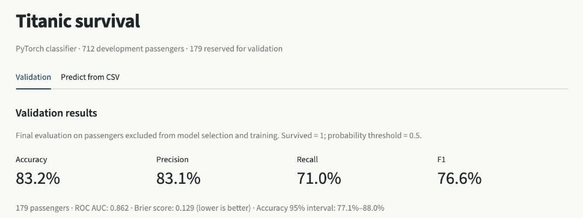
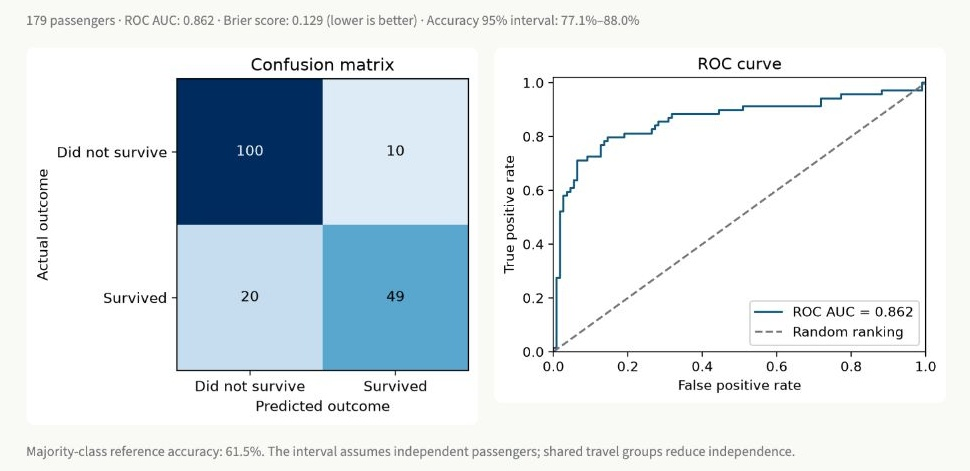
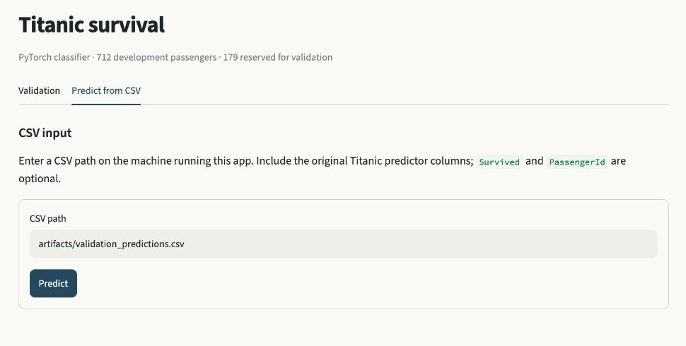
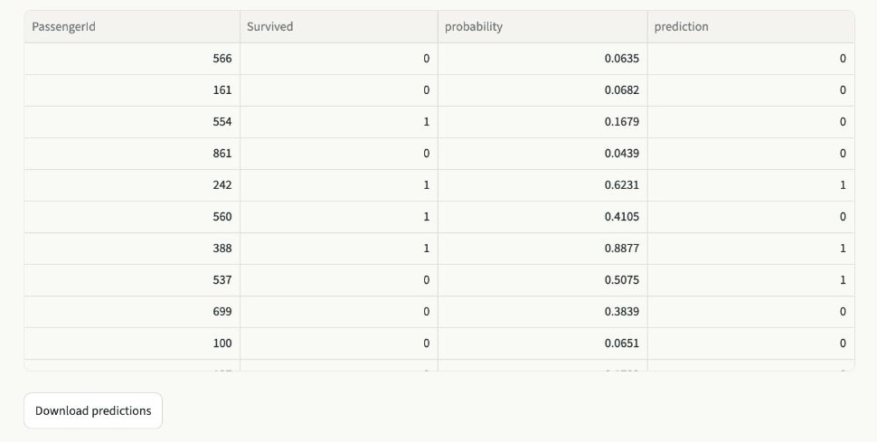

# Titanic survival classification

Titanic survival prediction with a PyTorch classifier, an EDA notebook and a
Streamlit app. The project uses only Kaggle `train.csv`.

The selected model scored **83.2% accuracy**, **76.6% F1** and **0.862 ROC AUC**
on 179 held-out passengers. See [RESULTS.md](RESULTS.md) for comparisons and limitations.

## Run the app

The saved model is included. **No training or Kaggle login is needed to open the app.**

1. Install the dependencies once (Python 3.12; tested on macOS CPU):

```bash
git clone https://github.com/guykalati/elta-titanic-assignment.git
cd elta-titanic-assignment
python3.12 -m venv .venv
source .venv/bin/activate
python -m pip install -r requirements.txt
```

2. Start Streamlit from the repository folder, with the virtual environment active:

```bash
python -m streamlit run ds_app.py
```

3. Open **http://localhost:8501** in your browser. If Streamlit selects another port,
   use the **Local URL** printed in the terminal. Keep that terminal running while
   using the app; press **Ctrl+C** to stop it.

For later launches, open a terminal in the repository folder and run:

```bash
source .venv/bin/activate
python -m streamlit run ds_app.py
```

### Example usage

- **Validation** shows held-out metrics, confusion matrix, ROC curve and development comparisons.
- **Predict from CSV** accepts a local CSV path and provides downloadable predictions.
  The default `artifacts/validation_predictions.csv` is a working labeled example.

Required predictors: `Pclass, Name, Sex, Age, SibSp, Parch, Ticket, Fare, Cabin, Embarked`.
`PassengerId` and `Survived` are optional. Missing Age/Fare/Cabin/Embarked values are
supported. Labels enable evaluation; a single-class file has no ROC AUC.
The app flags rows whose IDs appeared in training.

## Retrain (optional)

To rebuild the model, use the same environment and authenticate with Kaggle.
Accept the [competition rules](https://www.kaggle.com/competitions/titanic) if required:

```bash
kaggle auth login
python train.py
```

Training downloads only `train.csv`, creates a fixed stratified 712/179 split,
compares 18 configurations on five development folds, and saves the selected model
before evaluating the holdout. Preprocessing is fitted within each training fold.
A saved split receipt detects changed data or split settings.

Training also creates `data/validation.csv` and an unlabeled `data/inference_sample.csv`.

## Notebook and checks (optional)

```bash
python -m ipykernel install --prefix .venv --name elta-eda --display-name "Python (Elta assignment)"
jupyter lab eda.ipynb
python -m unittest test_data.py test_pipeline.py test_app.py
python ablation.py  # optional feature diagnostics on development data
```

Select **Python (Elta assignment)** in Jupyter. Saved notebook outputs are included.
`requirements.txt` pins direct dependencies; `requirements-lock.txt` records the tested environment.

## Files and model

| File | Purpose |
| --- | --- |
| `eda.ipynb` | Data quality, missingness, distributions and survival patterns |
| `data.py` | Kaggle download, data validation and recorded split |
| `features.py` | Feature extraction, imputation, encoding and scaling |
| `model.py` | PyTorch models, prediction and metrics |
| `train.py` | Model comparison, training and final evaluation |
| `ablation.py` | Optional feature-removal diagnostics |
| `ds_app.py` | Streamlit evaluation and CSV inference |
| `artifacts/` | Saved weights, preprocessing, metrics and predictions |

The selected classifier is a linear PyTorch model with engineered features,
averaging three fixed-seed fits. Small MLPs, XGBoost and Random Forest were also
compared. Features include title, family groups and demographic interactions.
Ticket counts come from the saved training reference, so predictions are independent
of other rows in an inference batch. Passenger IDs and raw names/tickets are not predictors.

## Screenshots

Validation metrics:



Confusion matrix and ROC curve:



CSV input (the included example works immediately):



Prediction output, showing four columns selected with the table's **Show/hide columns** control:



## References

Data: [Kaggle Titanic](https://www.kaggle.com/competitions/titanic/data).
All reported project scores come from local evaluation on `train.csv`.
